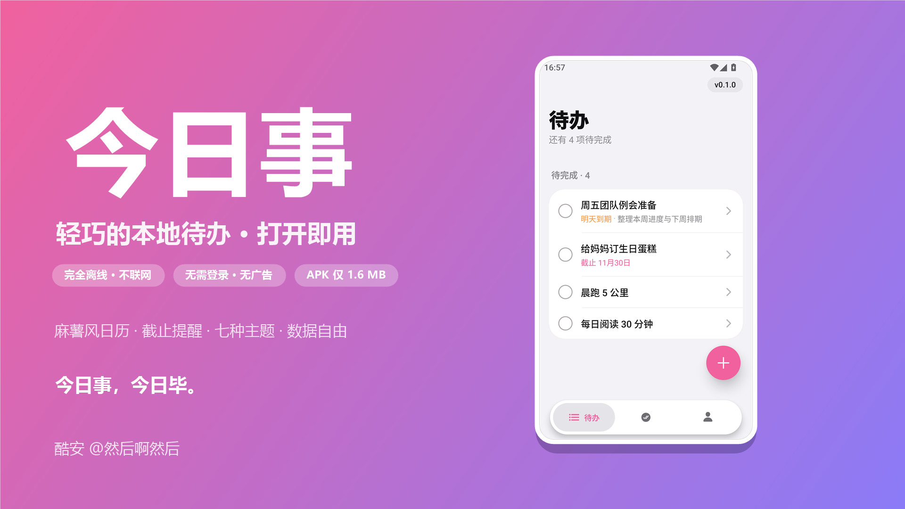
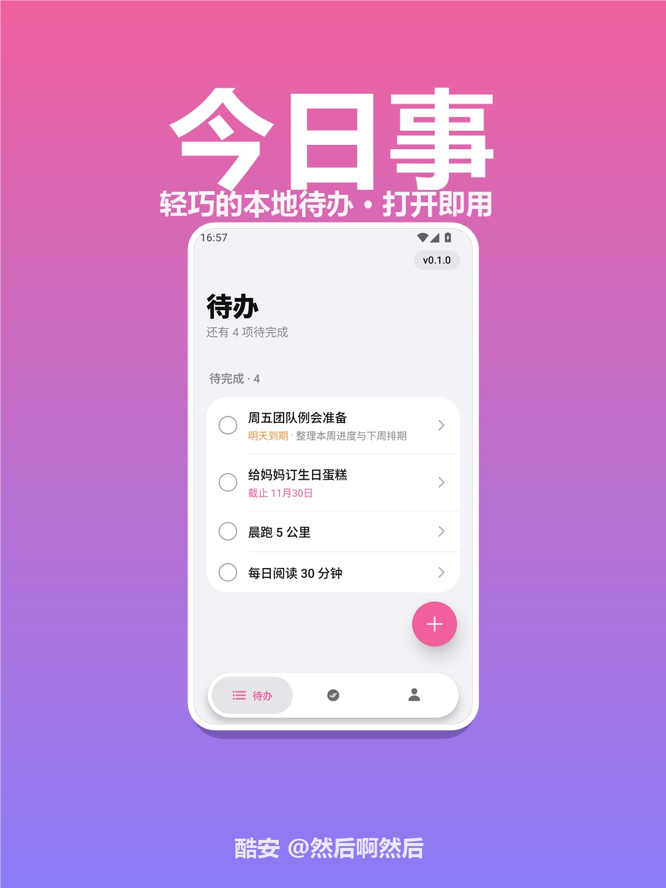
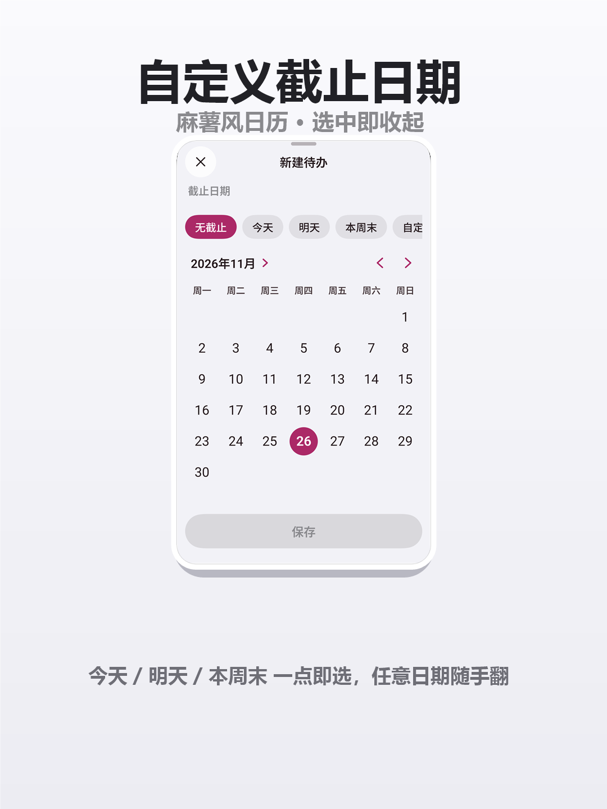
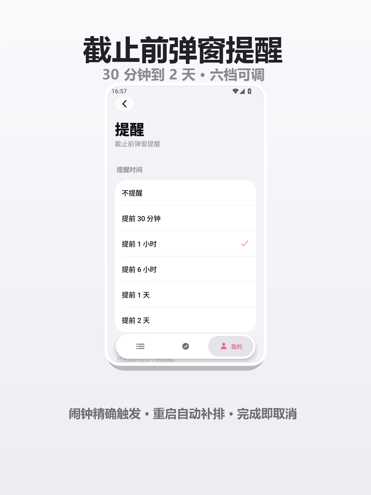
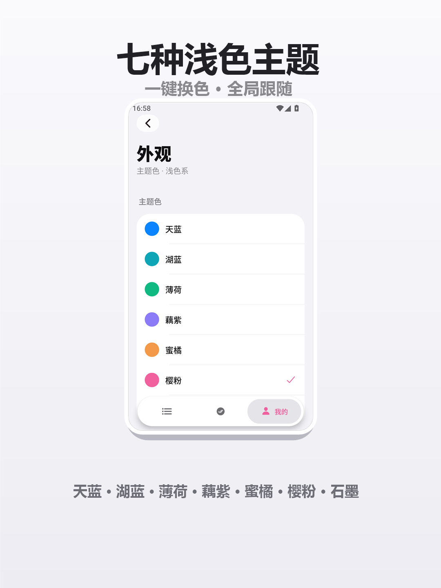

<div align="center">



# 今日事（TodoLite）

**轻巧的本地待办应用 — 打开即用 · 不联网 · 无登录 · 无广告**

[](https://github.com/ranhou2/TodoLite/releases)
[](https://developer.android.com)
[](https://github.com/ranhou2/TodoLite/releases)
[](https://kotlinlang.org)
[](https://developer.android.com/compose)

</div>

---

一款为"记录重要的事"而生的极简待办应用：全部数据保存在本机，不申请任何网络权限，安装即用，APK 仅 1.6 MB。

## 功能

- **麻薯风日历** — 今天 / 明天 / 本周末一点即选，任意日期随手翻，选中即收起
- **截止前弹窗提醒** — 提前 30 分钟到 2 天共六档，闹钟精确触发；重启自动补排，完成即取消
- **到期管理** — 有截止日期自动置顶排序，逾期标红、临近橙色
- **七种浅色主题** — 天蓝、湖蓝、薄荷、藕紫、蜜橘、樱粉、石墨，一键换色全局跟随
- **数据自由** — 任意路径导出 / 导入 JSON 备份，迁移无门槛
- **极致轻量** — R8 深度压缩，滚动零卡顿，老设备也能流畅运行

<p align="center">
  
  
  
</p>
<p align="center">
  
</p>

## 下载

前往 [**Releases**](https://github.com/ranhou2/TodoLite/releases) 下载最新版 APK（v0.1.0，1.6 MB）：

| 版本 | 说明 | 下载 |
| --- | --- | --- |
| v0.1.0 | 首个公开版本 | [TodoLite-v0.1.0.apk](https://github.com/ranhou2/TodoLite/releases/download/v0.1.0/TodoLite-v0.1.0.apk) |

安装即用，无任何内购、广告与联网行为。

## 技术栈

- Kotlin + Jetpack Compose（无需登录、完全离线）
- [mochi-compose](https://github.com/feice11/mochi-compose) 0.3.0（MIT）：全套 UI 组件与动效
- minSdk 26 / targetSdk 36 / AGP 9.1.0
- SharedPreferences + JSON 本地持久化（零额外依赖），AlarmManager 精确提醒

```
TodoLite/
├─ app/src/               # 全部 Kotlin 源码与资源
├─ gradle/wrapper/        # Gradle Wrapper
├─ build.gradle           # 根构建脚本
└─ settings.gradle        # 工程配置
```

## 构建

用 Android Studio 打开根目录即可；或命令行：

```bash
.\gradlew.bat assembleRelease
```

Release 已开启 R8 与资源裁剪，复用 debug 签名，产物在 `app/build/outputs/apk/release/`。

## 免责声明

本应用完全离线运行，不联网、不收集、不上传任何个人信息，所有数据仅保存在设备本地。
仅供个人学习与日常使用，请勿用于商业用途。重要数据请定期导出备份。

## 作者

酷安 [@然后啊然后](https://www.coolapk.com/)

## 赞赏

如果这个应用帮到了你，可以请作者喝杯奶茶：

<p align="center">
  
</p>
